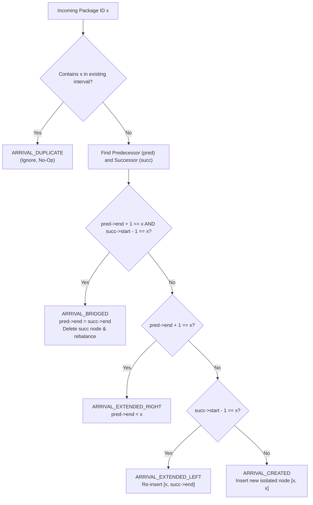

# Warehouse Live Arrival Index

[](https://en.wikipedia.org/wiki/C11_(C_standard_revision))
[]()
[]()

A high-performance, memory-efficient **Live Arrival Index** implemented in pure C11. Designed for warehouse logistics and ordered indexing, the system tracks out-of-order package arrivals as sorted, non-overlapping consecutive intervals in real-time.

---

## Problem Statement 09: The Warehouse's Broken Number Ranges

### Domain: Balanced Searching and Ordered Indexing

In high-throughput distribution centers, package trucks arrive out of sequence. Recording every individual package number creates unmanageable lists and exhausts memory. Managers require a real-time, compact representation of:
1. **Received Intervals**: Which consecutive package ranges have already arrived.
2. **Missing Gaps**: Which package numbers remain missing within any specified bounded query range $[L, R]$.

### Core Requirements
- **Out-of-Order Arrivals**: Accept nonnegative package IDs ($0 \le \text{ID} \le 10^9$) in arbitrary arrival sequence.
- **Sorted, Disjoint Intervals**: Maintain consecutive received numbers compactly as $[start, end]$.
- **Boundary Extension & Bridge Merging**:
  - Extend intervals when adjacent packages arrive ($start - 1$ or $end + 1$).
  - Bridge and fuse two disjoint intervals into a single range when the connecting package arrives.
- **Duplicate Resilience**: Silently ignore duplicate package arrivals without altering existing intervals.
- **Bounded Window Queries**: In $O(\log K + M)$ time, query received intervals and missing gaps within $[low, high]$.
- **Sparse ID Memory Efficiency**: Strictly $O(K)$ space (where $K$ is the number of active intervals), never allocating flat arrays or bitsets up to $10^9$.
- **Incremental Maintenance**: Avoid full re-sorting; update dynamically in $O(\log K)$ time per arrival.

---

## Architectural Design: Balanced AVL Interval Tree

To achieve strictly guaranteed logarithmic performance with zero memory bloat, the index employs a **Self-Balancing AVL Tree** of disjoint closed intervals $[start, end]$:

```
                            [100, 115]  (h=2)
                           /          \
                 [10, 25] (h=1)    [500, 520] (h=1)
```

### Invariants Maintained
1. **Disjointness**: For any two intervals $I_A$ and $I_B$, either $I_A.end < I_B.start - 1$ or $I_B.end < I_A.start - 1$.
2. **Total Ordering**: Ordered strictly by interval keys.
3. **Strict AVL Height Balance**: $|height(left) - height(right)| \le 1$ for all nodes.

### Arrival State Machine

When a package ID $x$ arrives:



---

## Complexity Analysis

| Operation | Live Arrival AVL Index | Flat Array | Bitset ($10^9$ bits) | Dynamic Array / Re-sort |
| :--- | :--- | :--- | :--- | :--- |
| **Arrival Insertion** | $\mathcal{O}(\log K)$ | $\mathcal{O}(1)$ | $\mathcal{O}(1)$ | $\mathcal{O}(N \log N)$ |
| **Bridge Merge** | $\mathcal{O}(\log K)$ | $\mathcal{O}(1)$ | $\mathcal{O}(1)$ | $\mathcal{O}(N \log N)$ |
| **Duplicate Check** | $\mathcal{O}(\log K)$ | $\mathcal{O}(1)$ | $\mathcal{O}(1)$ | $\mathcal{O}(N)$ or $\mathcal{O}(\log N)$ |
| **Range / Gap Query** | $\mathcal{O}(\log K + M)$ | $\mathcal{O}(R - L)$ | $\mathcal{O}((R - L) / 64)$ | $\mathcal{O}(N)$ |
| **Memory Consumption** | **$\mathcal{O}(K)$** (~32 B / interval) | **$\sim 4.0$ GB** | **$\sim 125$ MB** | $\mathcal{O}(N)$ |

Where:
- $N$ = Total packages received (up to 50,000)
- $K$ = Number of disjoint intervals ($K \le N$, often $K \ll N$)
- $M$ = Number of intervals overlapping the query window $[low, high]$

### Why It Remains Efficient for Widely Spaced Values
If 50,000 package IDs span IDs from $0$ to $1,000,000,000$:
- A standard array or direct-address table requires allocating index space for the maximum ID: $10^9 \times 4 \text{ bytes} \approx \mathbf{4.0\text{ GB}}$ of memory.
- A bitset requires $10^9 \text{ bits} \approx \mathbf{125\text{ MB}}$ of memory.
- In contrast, the **Live Arrival AVL Tree** allocates memory **only for active intervals**:
  - Consecutive arrivals merge into a single node.
  - Even with 50,000 completely disconnected packages, memory is $50,000 \times 32\text{ bytes} \approx \mathbf{1.6\text{ MB}}$.
  - When missing numbers arrive and connect adjacent intervals, the tree immediately frees redundant nodes, shrinking memory usage.

---

## Illustrative Walkthrough

Arrival sequence: `[1, 3, 7, 2, 6]`

1. **`1` arrives**: Creates interval `[[1, 1]]`.
2. **`3` arrives**: Creates interval `[[1, 1], [3, 3]]`.
3. **`7` arrives**: Creates interval `[[1, 1], [3, 3], [7, 7]]`.
4. **`2` arrives (Bridge Merge)**: Touches predecessor `1` ($1 + 1 = 2$) and successor `3` ($3 - 1 = 2$). Merges both into `[1, 3]`. Result: `[[1, 3], [7, 7]]`.
5. **`6` arrives (Left Extension)**: Touches successor `7` ($7 - 1 = 6$). Extends into `[6, 7]`. Result: `[[1, 3], [6, 7]]`.

### Query Window `[1, 7]`:
- **Received Ranges**: `[[1, 3], [6, 7]]`
- **Missing Gaps**: `[[4, 5]]`

---

## Project Structure

```
flashhack/
├── include/
│   └── warehouse_index.h     # Public API specification
├── src/
│   ├── avl_tree.h            # Internal AVL Tree definitions & declarations
│   ├── avl_tree.c            # AVL rotations, insertion, deletion, range traversal
│   ├── warehouse_index.c     # Core Live Arrival Index logic & reports
│   └── main.c                # Interactive CLI and demonstration suite
├── tests/
│   └── test_warehouse.c      # Comprehensive automated test suite (8 test suites)
├── Makefile                  # Build configuration (C11, -Wall, -Wextra, -Werror, -O3)
└── README.md                 # Complete documentation
```

---

## Building and Running

### Prerequisites
- Clang or GCC compiler with C11 support
- GNU Make

### Build Everything
```bash
make
```

### Run Automated Test Suite
```bash
make test
```

### Run Full Demonstration & Benchmark
```bash
make demo
```

### Interactive CLI Mode
```bash
./bin/warehouse interactive
```
Available interactive commands:
```
warehouse> add 10
Package 10 -> CREATED
warehouse> add 12
Package 12 -> CREATED
warehouse> add 11
Package 11 -> BRIDGED
warehouse> intervals
Current Intervals: [[10, 12]]
warehouse> report 5 15
Received Intervals within [5, 15]: [[10, 12]]
Missing Intervals (Gaps) within [5, 15]: [[5, 9], [13, 15]]
warehouse> quit
```

---

## Test Verification

The test suite (`make test`) validates:
- **Test 1**: Illustrative example from Problem Statement 09 (`[1, 3, 7, 2, 6]`).
- **Test 2**: Duplicate arrivals handling and idempotence.
- **Test 3**: Boundary extensions (both left and right).
- **Test 4**: Bridge merges connecting two disjoint intervals.
- **Test 5**: Multi-interval cascading bridge merges.
- **Test 6**: Bounded range queries and gap reports.
- **Test 7**: Sparse and extreme package IDs ($0$ to $10^9$).
- **Test 8**: Stress benchmark with 50,000 unique arrivals verifying AVL invariants.
